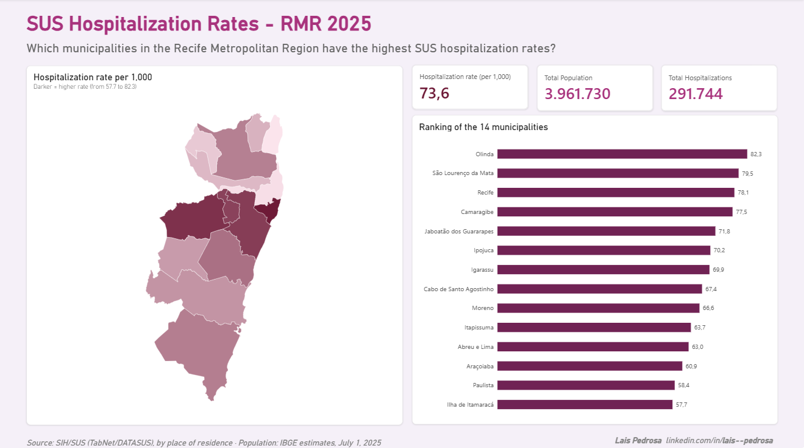
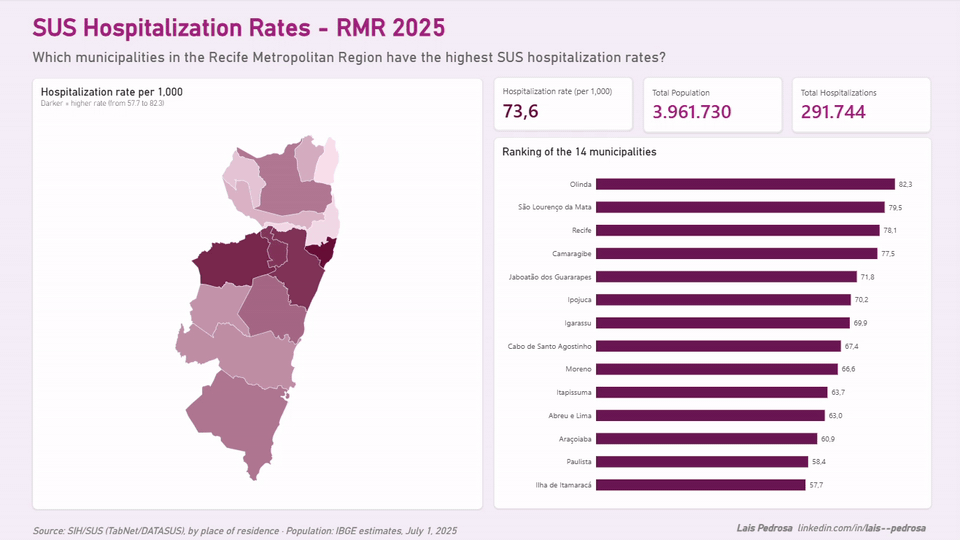

# SUS Hospitalization Rates – Recife Metropolitan Region (2025)

**Which municipalities in the Recife Metropolitan Region (RMR) have the highest hospitalization rates in Brazil's public health system (SUS) per 1,000 inhabitants?**

This project answers that question using public data from the Brazilian Ministry of Health and IBGE, cleaned and analyzed in Python (pandas).

## Main result

| Rank | Municipality | Hospitalizations (2025) | Population (2025) | Rate per 1,000 |
|---:|---|---:|---:|---:|
| 1 | Olinda | 30,016 | 364,717 | **82.3** |
| 2 | São Lourenço da Mata | 9,397 | 118,258 | **79.5** |
| 3 | Recife | 124,014 | 1,588,376 | **78.1** |
| 4 | Camaragibe | 12,093 | 156,112 | 77.5 |
| 5 | Jaboatão dos Guararapes | 49,138 | 684,293 | 71.8 |
| 6 | Ipojuca | 7,474 | 106,539 | 70.2 |
| 7 | Igarassu | 8,595 | 123,017 | 69.9 |
| 8 | Cabo de Santo Agostinho | 14,698 | 218,049 | 67.4 |
| 9 | Moreno | 3,838 | 57,654 | 66.6 |
| 10 | Itapissuma | 1,891 | 29,669 | 63.7 |
| 11 | Abreu e Lima | 6,566 | 104,248 | 63.0 |
| 12 | Araçoiaba | 1,218 | 19,996 | 60.9 |
| 13 | Paulista | 21,326 | 365,144 | 58.4 |
| 14 | Ilha de Itamaracá | 1,480 | 25,658 | 57.7 |

- **Olinda's rate is about 43% higher than Ilha de Itamaracá's.**
- **Recife has by far the most hospitalizations, but it is not first:** once population size is taken into account, Olinda and São Lourenço da Mata come ahead.
- A low rate is not always good news: it may also reflect poorer access to hospitals.
- **The map suggests a center–periphery pattern:** the highest rates form a band around Recife (São Lourenço da Mata, Camaragibe, Recife and Olinda), while the northern and southern ends of the region have lower rates. Paulista, right next to Olinda, is an exception worth investigating.

## Power BI dashboard



The dashboard (`painel_internacoes_rmr.pbix`) has two pages:

- **Overview:** a choropleth map of the 14 municipalities, the ranking by rate, and cards with the RMR totals.
- **Data:** the detailed table by municipality, with the totals.

Clicking a municipality on the map or in the ranking filters the whole page:



Highlights:

- **DAX measures** for total hospitalizations, total population and the rate. The RMR rate is computed as total hospitalizations ÷ total population × 1,000 (**73.6**), not as the average of the 14 municipal rates (69.1), which would give a small municipality the same weight as Recife.
- **Choropleth map** built with the Shape Map visual and the official IBGE municipal boundaries, filtered to the 14 RMR municipalities and converted to TopoJSON with [mapshaper](https://mapshaper.org). The map is linked to the data by the 6-digit municipality code.
- **Power Query** steps: decimal separator fixed with an en-US locale, data types, readable column names and municipality names with accents.

## Data

| Data | Source | Details |
|---|---|---|
| Hospitalizations | SIH/SUS (Hospital Information System), via [TabNet/DATASUS](http://tabnet.datasus.gov.br/cgi/deftohtm.exe?sih/cnv/nrpe.def) | By **place of residence**, by **year of admission** (2025). Accessed in November 2026 |
| Population | [IBGE Population Estimates](https://www.ibge.gov.br/estatisticas/sociais/populacao/9103-estimativas-de-populacao.html) | Reference date: July 1, 2025 |
| RMR definition | Lei Complementar Estadual nº 382/2018, as amended by [Lei Complementar nº 426/2020](https://legis.alepe.pe.gov.br/texto.aspx?tiponorma=2&numero=426&complemento=0&ano=2020&tipo=&url=) | 14 municipalities (Goiana was removed in 2020) |
| Municipal boundaries | [IBGE Territorial Meshes](https://www.ibge.gov.br/geociencias/organizacao-do-territorio/malhas-territoriais/15774-malhas.html) | Pernambuco municipal mesh, 2025 edition (used in the dashboard map) |

Only aggregated data by municipality was used. No individual patient data.

## Method

1. **Load** the TabNet CSV (Latin-1 encoding, `;` separator, title and footer lines).
2. **Clean**: keep 2025 only, split the municipality code from the name, remove the Total row, check for missing values.
3. **Filter** the 14 RMR municipalities by IBGE code (not by name, to avoid accent and spelling issues).
4. **Join** with IBGE population (7-digit IBGE codes converted to the 6-digit DATASUS format) and compute **rate = hospitalizations ÷ population × 1,000**.
5. **Sort** and save the final table to `data/taxa_internacao_rmr_2025.csv`.
6. **Visualize** the final table in a Power BI dashboard.

Each step, decision and check is explained in the notebook.

## Limitations

- **SUS only:** private hospitalizations are not included.
- **Hospitalizations, not people:** the same person can be counted more than once (readmissions).
- **Address on the hospitalization form (AIH)** may not match the actual residence.
- **Crude rate:** not adjusted for age or broken down by cause.
- **Data subject to updates:** late records may still slightly change the 2025 numbers.

**Next steps:** age-standardized rates and hospitalizations for ambulatory care-sensitive conditions (ICSAP).

## Repository structure

```
├── data/
│   ├── geo/
│   │   └── rmr_municipios.json                              # RMR boundaries (TopoJSON)
│   ├── internacoes_pernambuco_atend_2024-2026_tabnet.csv   # raw data, TabNet
│   ├── ibge_populacao_2025.xls                              # raw data, IBGE
│   └── taxa_internacao_rmr_2025.csv                         # final result
├── figures/                                                 # dashboard screenshots
├── notebook_internacoes_rmr.ipynb                           # full analysis
├── painel_internacoes_rmr.pbix                              # Power BI dashboard
└── README.md
```

## How to run

**Analysis (notebook)**

1. Python 3.12
2. Install the packages: `pip install pandas xlrd ipykernel`
3. Open `notebook_internacoes_rmr.ipynb` and run all cells.

**Dashboard**

Open `painel_internacoes_rmr.pbix` in Power BI Desktop (free, Windows).

## Tools

Python · pandas · Jupyter · VS Code · Power BI (Power Query, DAX, Shape Map) · mapshaper

---

## 🇧🇷 Resumo em português

**Pergunta:** quais municípios da Região Metropolitana do Recife (RMR) têm as maiores taxas de internação no SUS por mil habitantes?

**Resultado:** em 2025, **Olinda (82,3)**, **São Lourenço da Mata (79,5)** e **Recife (78,1)** lideram. **Paulista (58,4)** e **Ilha de Itamaracá (57,7)** têm as menores taxas. O Recife tem, de longe, o maior número de internações, mas não fica em primeiro, porque a taxa leva em conta o tamanho da população.

**Dados:** internações do SIH/SUS (TabNet/DATASUS), por local de residência e ano de atendimento; população das estimativas do IBGE (1º/07/2025); 14 municípios da RMR conforme a LC estadual 382/2018, alterada pela LC 426/2020.

**Padrão no mapa:** as maiores taxas formam uma faixa em torno do Recife, e as pontas norte e sul da região têm taxas menores. Paulista, vizinha de Olinda, é uma exceção.

**Limitações:** só SUS; conta internações, não pessoas; taxa bruta (sem ajuste por idade); dados sujeitos a atualização.

**Painel:** Power BI com mapa coroplético (malha municipal do IBGE), ranking e medidas em DAX. A taxa da RMR (73,6) é calculada como soma das internações ÷ soma da população × 1.000, e não como a média das 14 taxas.

A análise completa, com cada decisão explicada, está no notebook (em inglês).
